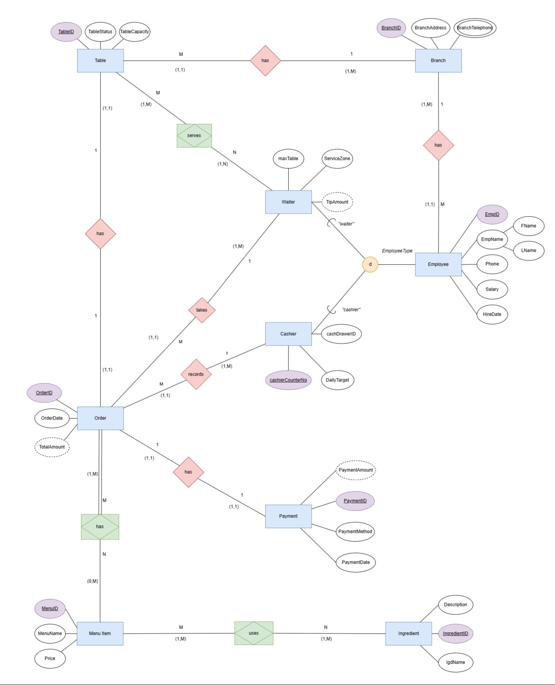
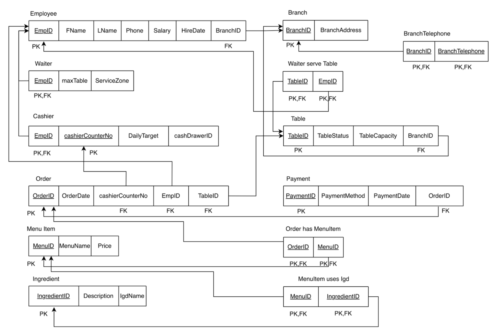
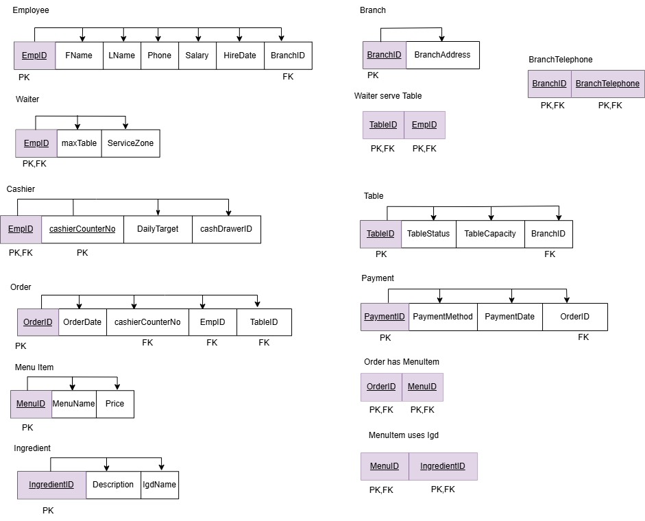

# 🍰 After You Dessert Cafe — Relational Database System Design

[](#)
[](#)
[](#)
[](#)

สถาปัตยกรรมและแบบจำลองฐานข้อมูลเชิงสัมพันธ์แบบครบวงจร (End-to-End Relational Database System Design) สำหรับธุรกิจร้านขนมหวานหลายสาขา โดยใช้กรณีศึกษาจริงของ **After You Dessert Cafe** (มีมากกว่า 44 สาขาทั่วประเทศ) 

โปรเจกต์นี้ครอบคลุมกระบวนการทางวิศวกรรมฐานข้อมูลตั้งแต่การศึกษา Business Domain, การสร้างแบบจำลองแนวคิด (Conceptual EER Modeling), การแปลงเป็นแบบจำลองเชิงตรรกะ (8-Step Transform Mapping) จนถึงการทำนอร์มัลไลเซชันระดับ 3 (Third Normal Form: 3NF) เพื่อให้ได้โครงสร้างข้อมูลที่ถูกต้อง มีความสมบูรณ์เชิงสัมพันธ์ (Referential Integrity) ปราศจากความซ้ำซ้อน และพร้อมรองรับการพัฒนาระบบซอฟต์แวร์จริง

---

## 🎯 วัตถุประสงค์และขอบเขตของระบบ (System Scope & Objectives)

ระบบฐานข้อมูลนี้ถูกออกแบบขึ้นเพื่อสนับสนุนการดำเนินงาน 3 ระบบหลักของธุรกิจร้านอาหาร/ขนมหวานขนาดใหญ่:

```
+-----------------------------------------------------------------------------------------+
|                                After You Database System                                |
+-----------------------------+-----------------------------+-----------------------------+
|   1. ระบบจัดการสาขาและโต๊ะ   |  2. ระบบสั่งซื้อหน้าร้าน (POS) | 3. ระบบจัดการเมนูและวัตถุดิบ |
|   (Branch & Table Ops)      |      (Point of Sale)        |     (Menu & Inventory BOM)  |
+-----------------------------+-----------------------------+-----------------------------+
| • ข้อมูลสาขาและเบอร์ติดต่อ    | • การสั่งซื้อแบบ Pay First  | • โครงสร้างรายการเมนู       |
| • การจัดสรรพนักงานรายสาขา   | • แยกหน้าที่ Cashier/Waiter | • สูตรส่วนประกอบเมนู (BOM)  |
| • จัดการสถานะโต๊ะ Real-time | • บันทึกกะ/ลิ้นชัก/เป้ายอดขาย| • การตัดสต็อกแบบ FIFO       |
|   (ว่าง/กำลังใช้/ทำความสะอาด)| • ประวัติการชำระเงิน (1:1)   | • ควบคุมสต็อกขั้นต่ำ        |
+-----------------------------+-----------------------------+-----------------------------+
```

### 1. ระบบจัดการสาขาและโต๊ะ (Branch & Table Management)
* จัดเก็บข้อมูลสาขา ที่ตั้ง และหมายเลขโทรศัพท์ติดต่อ (รองรับการมีหลายหมายเลขโทรศัพท์ต่อสาขา)
* ควบคุมข้อมูลโต๊ะ ความจุที่นั่ง และสถานะการให้บริการแบบ Real-time (`ว่าง`, `กำลังใช้งาน`, `กำลังทำความสะอาด`) เพื่อบริหารคิวและพื้นที่อย่างมีประสิทธิภาพ
* บริหารบุคลากรและการจัดสรรพนักงานประจำแต่ละสาขา

### 2. ระบบสั่งซื้อหน้าร้าน (In-Store POS & Pay-First Ordering)
* รองรับโมเดลการให้บริการแบบ **Pay First** (ชำระเงินก่อนรับอาหาร)
* ออกแบบการสืบทอดคุณสมบัติของพนักงาน (Specialization Hierarchy) ตามบทบาทจริง:
  * **แคชเชียร์ (Cashier)**: บันทึกออเดอร์, คุมลิ้นชักเงิน (`cashDrawerID`), ประจำเคาน์เตอร์ตามกะ (`cashierCounterNo`) และเป้าหมายยอดขายรายวัน (`DailyTarget`)
  * **พนักงานเสิร์ฟ (Waiter)**: รับผิดชอบโซนให้บริการ (`ServiceZone`), รองรับโต๊ะสูงสุดตามศักยภาพ (`maxTable`) และติดตามยอดทิป (`TipAmount`)
* ความสัมพันธ์ระหว่างออเดอร์กับการชำระเงินเป็นแบบ 1:1 Transactional Integrity บันทึกช่องทางการชำระ (เงินสด, QR Code, บัตรเครดิต)

### 3. ระบบจัดการเมนูและคลังวัตถุดิบ (Menu & Recipe Inventory Tracking)
* จัดเก็บรายการของหวานและเครื่องดื่ม พร้อมระดับราคา
* จัดเก็บฐานข้อมูลวัตถุดิบและคำอธิบายเพื่อรองรับการตรวจรับสต็อกตามหลัก First-In, First-Out (FIFO)
* ความสัมพันธ์แบบกลุ่มต่อกลุ่ม (M:N) ระหว่างเมนูกับวัตถุดิบ เพื่อทำหน้าที่เป็น **Bill of Materials (BOM)** สำหรับตัดสต็อกวัตถุดิบอัตโนมัติเมื่อเกิดคำสั่งซื้อ

---

## 🏗️ สถาปัตยกรรมการออกแบบฐานข้อมูล (Database Architecture)

### 1. แบบจำลองแนวคิด (Conceptual Data Model: Peter Chen EER)

โครงสร้างระดับแนวคิดถูกสร้างขึ้นตามมาตรฐาน Peter Chen Extended Entity-Relationship Model เพื่อสะท้อนข้อกำหนดทางธุรกิจอย่างครบถ้วน:

* **Disjoint Specialization (`d`)**: `Employee` เป็น Superclass แตกออกเป็น `Cashier` และ `Waiter` โดยมี `EmployeeType` เป็นตัวจำแนก (Disjoint Predicate)
* **Multi-Valued Attribute**: `BranchTelephone` บน Entity `Branch` (ใช้สัญลักษณ์วงรีซ้อน)
* **Composite Attribute**: `EmpName` ประกอบด้วย `FName` และ `LName`
* **Derived Attributes**: `TotalAmount` (คำนวณจากยอดรวมของเมนูในออเดอร์), `PaymentAmount`, `TipAmount` (ใช้วงรีเส้นประ)
* **Structural Constraints**: กำหนด Cardinality Ratio และ Participation Constraints ในรูปแบบ `(min, max)` ทุกจุดเชื่อมโยง



---

### 2. กระบวนการแปลงเป็นแบบจำลองเชิงตรรกะ (8-Step Transform Mapping)

ดำเนินการแปลงจาก EER Diagram สู่ Relational Schema ตามลำดับขั้นตอนทางวิชาการ:

```
[EER Diagram] 
      │
      ├─ Step 1: Mapping of Regular (Strong) Entities ────► Employee, Branch, Table, Order, MenuItem, Ingredient
      ├─ Step 2: Mapping of Weak Entity Types ────────────► (ไม่มี Weak Entity ในระบบ)
      ├─ Step 3: Mapping of Binary 1:1 Relationships ─────► Order <-> Payment (ฝาก OrderID ในตาราง Payment)
      ├─ Step 4: Mapping of Binary 1:N Relationships ─────► Branch->Table, Branch->Employee, Cashier->Order, Table->Order
      ├─ Step 5: Mapping of Binary M:N Relationships ─────► Waiter_serve_Table, Order_has_MenuItem, MenuItem_uses_Igd
      ├─ Step 6: Mapping of Multi-Valued Attributes ──────► แยกสร้างตาราง BranchTelephone
      ├─ Step 7: Mapping of N-ary Relationships ──────────► (ไม่มี N-ary ในระบบ)
      └─ Step 8: Mapping of Specialization/Generalization ─► Option 8A: ตาราง Superclass + ตาราง Subclasses (Waiter, Cashier)
      │
      ▼
[Relational Schema (10+ ตารางสัมพันธ์)]
```



---

## 🗃️ สรุปโครงสร้างตารางและความสัมพันธ์ (Relational Schema Specification)

ระบบประกอบด้วยตารางข้อมูลที่สมบูรณ์ทั้งหมด 13 ตาราง (รวมตารางเชื่อมโยงความสัมพันธ์และ Multi-valued Table):

| ตาราง (Relation) | Primary Key (PK) | Foreign Key (FK) & Reference | คำอธิบายหน้าที่ |
|---|---|---|---|
| **`Branch`** | `BranchID` | - | ข้อมูลสาขาและที่อยู่ |
| **`BranchTelephone`** | `(BranchID, BranchTelephone)` | `BranchID` $\rightarrow$ `Branch(BranchID)` | จัดเก็บหมายเลขโทรศัพท์ประจำสาขา (แปลงจาก Multi-valued) |
| **`Table`** | `TableID` | `BranchID` $\rightarrow$ `Branch(BranchID)` | ข้อมูลโต๊ะ ความจุที่นั่ง และสถานะของโต๊ะ |
| **`Employee`** | `EmpID` | `BranchID` $\rightarrow$ `Branch(BranchID)` | ข้อมูลพนักงานทั่วไป (ชื่อ, นามสกุล, เบอร์โทร, เงินเดือน, วันที่เริ่มงาน) |
| **`Waiter`** | `EmpID` | `EmpID` $\rightarrow$ `Employee(EmpID)` | ข้อมูลเฉพาะของพนักงานเสิร์ฟ (โซนบริการ, โควตาโต๊ะสูงสุด) |
| **`Cashier`** | `(EmpID, cashierCounterNo)` | `EmpID` $\rightarrow$ `Employee(EmpID)` | ข้อมูลเฉพาะของแคชเชียร์ (ลิ้นชักเงิน, เป้าหมายยอดขายประจำกะ) |
| **`Waiter_serve_Table`** | `(TableID, EmpID)` | `TableID` $\rightarrow$ `Table`, `EmpID` $\rightarrow$ `Waiter` | ตารางเชื่อมโยงการให้บริการโต๊ะของพนักงานเสิร์ฟ (M:N) |
| **`Order`** | `OrderID` | `(cashierCounterNo, EmpID)` $\rightarrow$ `Cashier`, `TableID` $\rightarrow$ `Table` | ข้อมูลคำสั่งซื้อ วันเวลา และยอดรวม |
| **`Payment`** | `PaymentID` | `OrderID` $\rightarrow$ `Order(OrderID)` | รายการชำระเงิน วิธีการชำระ และวันเวลา (1:1 กับ Order) |
| **`MenuItem`** | `MenuID` | - | รายการสินค้า/ของหวาน/เครื่องดื่ม และราคาจำหน่าย |
| **`Order_has_MenuItem`** | `(OrderID, MenuID)` | `OrderID` $\rightarrow$ `Order`, `MenuID` $\rightarrow$ `MenuItem` | รายละเอียดเมนูที่สั่งในแต่ละออเดอร์ (M:N) |
| **`Ingredient`** | `IngredientID` | - | รายการวัตถุดิบและคำอธิบายวัตถุดิบ |
| **`MenuItem_uses_Igd`** | `(MenuID, IngredientID)` | `MenuID` $\rightarrow$ `MenuItem`, `IngredientID` $\rightarrow$ `Ingredient` | สูตรการใช้วัตถุดิบของแต่ละเมนูเพื่อการตัดสต็อก (BOM) (M:N) |

---

## 🔍 การวิเคราะห์และตรวจสอบความถูกต้องตามหลักนอร์มัลไลเซชัน (3NF Audit)

ตารางทั้งหมดในระบบผ่านการตรวจสอบตามทฤษฎีการพึ่งพาเชิงฟังก์ชัน (Functional Dependency: FD) และได้รับการรับรองว่าอยู่ในระดับ **Third Normal Form (3NF)**



### กรณีศึกษาการตรวจสอบตาราง `Cashier`:
ตาราง `Cashier` มีคีย์หลักร่วม (Composite Primary Key) คือ `(EmpID, cashierCounterNo)` มีรายละเอียดการตรวจสอบดังนี้:

1. **First Normal Form (1NF)**:
   * ทุก Attribute มีค่าเดี่ยว (Atomic Values) ไม่มีการเก็บกลุ่มข้อมูลซ้ำ (Repeating Groups) หรือ List/Array ภายในคอลัมน์เดียวกัน
   * ทุกคอลัมน์มีชนิดข้อมูลที่แน่นอน และมีคีย์หลักร่วมระบุแต่ละแถวได้อย่างชัดเจน

2. **Second Normal Form (2NF)**:
   * โครงสร้างตารางผ่านเกณฑ์ 1NF
   * **ขจัด Partial Functional Dependency**: แอตทริบิวต์ที่ไม่ใช่คีย์ (`DailyTarget`, `cashDrawerID`) พึ่งพาคีย์หลักร่วมทั้งสองตัวแบบ **Full Functional Dependency**:
     * `DailyTarget` (เป้าหมายยอดขาย): ไม่สามารถระบุได้ด้วย `EmpID` อย่างเดียว เพราะเป้าหมายขึ้นอยู่กับเคาน์เตอร์/กะที่ปฏิบัติงาน และไม่สามารถระบุด้วย `cashierCounterNo` อย่างเดียว เพราะพนักงานแต่ละคนมีเป้าหมายต่างกัน
     * `cashDrawerID` (รหัสลิ้นชักเงิน): เปลี่ยนไปตามผู้ปฏิบัติงานและเคาน์เตอร์ที่ใช้งานจริงในแต่ละกะ
     * *สรุป*: Non-key attributes ขึ้นตรงต่อ `(EmpID, cashierCounterNo)` ร่วมกัน ไม่พึ่งพาเพียงส่วนใดส่วนหนึ่งของคีย์

3. **Third Normal Form (3NF)**:
   * โครงสร้างตารางผ่านเกณฑ์ 2NF
   * **ขจัด Transitive Dependency**: ไม่มีความสัมพันธ์แบบพึ่งพาต่อเนื่องระหว่างแอตทริบิวต์ที่ไม่ใช่คีย์ (`No Non-key -> Non-key dependencies`) โดย `DailyTarget` และ `cashDrawerID` เป็นอิสระต่อกันและขึ้นตรงต่อ Candidate Key / Primary Key เท่านั้น

---

## 📂 โครงสร้างไฟล์ใน Repository (Project Structure)

```text
Database Design Project - After You Dessert Shop/
├── README.md                                    # เอกสารนำเสนอโปรเจกต์ฉบับหลักบน GitHub
├── Readme.txt                                   # เอกสารสรุปเนื้อหาทางเทคนิค (Plain-text version)
├── Report.pdf                                   # รายงานวิชาการฉบับสมบูรณ์ (จำนวน 29 หน้า)
└── Organized_By_Section/                        # ไดอะแกรมและแผนภาพสถาปัตยกรรมระบบ
    ├── Section4_ER_EER_Diagram_Chen.jpg         # แผนภาพ Peter Chen ER/EER Diagram ฉบับเต็ม
    ├── Section5_Relation_Schema_Full.png        # แผนผัง Relational Schema รวมทุกตารางและความสัมพันธ์
    ├── Section5_Step1_Regular_Entity.jpg        # Transform Mapping Step 1: Regular Entity
    ├── Section5_Step3_1_to_1_Relationship.jpg   # Transform Mapping Step 3: 1:1 Relationship
    ├── Section5_Step4_1_to_N_Relationship.jpg   # Transform Mapping Step 4: 1:N Relationship
    ├── Section5_Step5_M_to_N_Relationship.jpg   # Transform Mapping Step 5: M:N Relationship
    ├── Section5_Step6_Multi_Valued_Attribute.jpg # Transform Mapping Step 6: Multi-Valued Attribute
    ├── Section5_Step8_Specialization_Generalization.jpg # Transform Mapping Step 8: Disjoint Hierarchy
    └── Section6_Third_Normal_Form_3NF.jpg       # แผนผังแสดงการพิสูจน์คุณสมบัติระดับ 3NF
```

---

## 💡 ทักษะและสมรรถนะเชิงเทคนิคที่แสดงในโปรเจกต์นี้ (Core Competencies)

* **Business System Analysis**: การวิเคราะห์ข้อกำหนดทางธุรกิจของระบบค้าปลีกและร้านอาหาร (POS, Table Status Management, Inventory BOM)
* **Conceptual Data Modeling**: การสร้าง Extended Entity-Relationship Model ด้วย Peter Chen Notation, การออกแบบ Disjoint Generalization/Specialization, การจัดการ Multi-Valued Attributes
* **Logical Database Design**: การประยุกต์ใช้ 8-Step Transform Mapping Algorithm เพื่อแปลงแบบจำลองแนวคิดไปสู่ Relational Tables ที่มี Referential Integrity ครบถ้วน
* **Database Normalization**: การวิเคราะห์ Functional Dependency และการพิสูจน์ตามหลัก 1NF, 2NF และ 3NF เพื่อขจัดความซ้ำซ้อนและการอัปเดตข้อมูลที่ผิดพลาด (Update/Insert/Delete Anomalies)
* **Technical Documentation**: การจัดทำ Data Dictionary, กฎเกณฑ์ทางธุรกิจ (Business Rules) และรายงานสเปกข้อมูลอย่างเป็นระบบ
